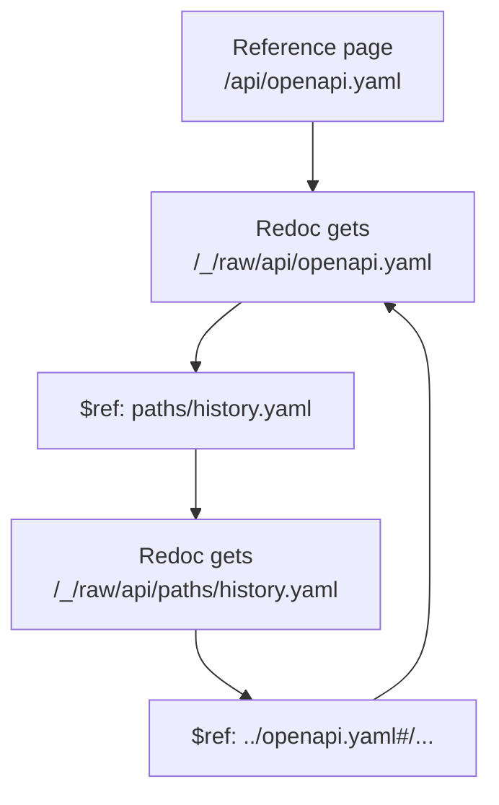

# API specs

The viewer can show an OpenAPI spec as an API reference page. Redoc 2.5.4
renders the reference in the browser. The page keeps the viewer layout:
the file tree, the header, and the linked mentions.

This repository is the example. [api/openapi.yaml](../api/openapi.yaml)
describes the JSON routes of the viewer, and `make docs` shows it as a
reference page. It is a split spec: one path is in
[api/paths/history.yaml](../api/paths/history.yaml).

## Set the spec vault

1. Put the OpenAPI specs in one directory, for example `api/`.
2. Add that directory to `-vaults`.
3. Give the same directory to `-spec-vault`.

```sh
docs-viewer -vaults docs,api -spec-vault api
```

The spec vault must be one of the vaults. If it is not, the viewer does
not start.

A `.yaml` or `.yml` file in the spec vault opens as an API reference page
when a line starts with the top-level key `openapi:` or `swagger:`. Other
files in the spec vault open as usual: a note as a note, and other text as
a source page. Thus, a file of a [split spec](#split-specs), such as
`api/paths/history.yaml`, opens as a source page.

## Pages of a spec

| URL | Page |
|-----|------|
| `/api/openapi.yaml` | The reference. If the file has changes against the compare base, the diff. See [GIT-DIFF.md](GIT-DIFF.md#diff-mode). |
| `/api/openapi.yaml?diff=off` | The reference. This is the "Reference" link. |
| `/api/openapi.yaml?diff=off&view=source` | The YAML with syntax colors. This is the "Source" link. |
| `/api/openapi.yaml?raw=1` | The YAML file as plain text. |
| `/_/raw/api/openapi.yaml` | The YAML file as plain text. Redoc reads the spec from this URL. |

The header of a spec page has the "Reference / Source" control. It changes
between the two forms of the page.

## Split specs

A spec can put parts of its content in other files. A `$ref` with a
relative path refers to such a file:

```yaml
# api/openapi.yaml
paths:
  /_/api/history:
    $ref: paths/history.yaml
```

```yaml
# api/paths/history.yaml
get:
  responses:
    '200':
      content:
        application/json:
          schema:
            $ref: '../openapi.yaml#/components/schemas/History'
```

In the referenced file, `#/components/...` refers to that file. To refer
to the root spec, put the path of the root spec before the `#`.

Redoc resolves a relative `$ref` against the URL of the spec. The spec URL
is `/_/raw/api/openapi.yaml`, so `paths/history.yaml` becomes
`/_/raw/api/paths/history.yaml`. Each path below `/_/raw/` gives the file
as plain text. Thus, Redoc reads each file of the spec.

A referenced file can be outside the spec vault, for example
`../shared/errors.yaml`. `/_/raw/` gives each repository file that the
viewer shows, as `?raw=1` does. Hidden files and `node_modules` stay
closed.



## Links to a spec

A note links to a spec as to any file:

```markdown
The [viewer API](../api/openapi.yaml) has five routes.

See [[api/openapi.yaml]] for the response fields.

The [search route](../api/openapi.yaml#operation/searchNotes) has one parameter.
```

- A link fragment such as `#operation/searchNotes` opens that operation.
  The text after `operation/` is the `operationId` of the spec.
- The reference page shows the notes that link to the spec in "Linked
  mentions".
- Search, the quick switcher, and the graph list notes only. They do not
  list a spec.

## Live reload

When you save the spec, the reference renders again in place. The section
at the top of the view stays at the same position.

At a bare URL, the first edit of a clean file opens the diff, as for each
file.

## Theme

The viewer builds the Redoc theme from the properties of the viewer theme:
the accent, the text and border colors, the backgrounds, the code colors,
the `--c-*` hues, and the two font families. The colors of the HTTP
methods come from `--c-blue`, `--c-green`, `--c-orange`, and `--c-red`.

Redoc sets some colors in its own styles. `viewer.css` replaces them with
theme properties:

- A Markdown table in a description gets the colors of a table in a note:
  `--border`, `--table-header-bg`, and `--table-row-alt`.
- A code block in a description gets `--code-bg` and `--code-text`,
  with no text shadow and no border on each line.
- The code samples get `--code-text` for the keys, and a `--c-*` hue
  mixed with `--text-normal` for the strings, the numbers, and the other
  values. Redoc's own colors are for a dark panel, and the sample panel
  has the `--code-bg` of the theme. Thus, without this change, the keys
  were white on white in the light theme.

Thus, a custom theme also applies to the reference. See
[THEMES.md](THEMES.md). When you change between light and dark, the
reference renders again.

## Content security policy

Redoc starts a worker from a `blob:` URL for its search. Thus, only the
reference page adds this directive to the content security policy:

```text
worker-src 'self' blob:
```

All other pages, the source form, and the raw file keep the standard
policy. See [ARCHITECTURE.md](ARCHITECTURE.md#security).

Because the policy is different, the browser does a full page load when
you open or leave a reference page.

The menu of Redoc tries to load a logo from the host `cdn.redoc.ly`. The
viewer stops that request, so the page loads nothing from another host.

## Known limits

- The viewer scrolls its content pane, but Redoc monitors the scroll of
  the window. Thus, the Redoc menu does not follow the scroll position.
  Menu clicks and links work.
- The hover preview of a spec link shows no reference.
- Only YAML files open as a reference. A spec in a `.json` file opens as a
  source page.
- A YAML file outside the spec vault opens as a source page.
- The viewer examines only the top-level `openapi:` or `swagger:` key.
  If a YAML file has the key but is not a valid spec, Redoc shows an
  error. Use the "Source" link to read such a file.
- A YAML file larger than 8 MiB always opens as a reference, because the
  viewer does not read it to find the key.
- The viewer has one spec vault.
- Live reload renders the reference again when the root spec changes.
  When you save only a referenced file, the reference stays as it is.
  Load the page again to see the change.

## How it was checked

`docsview/apispec_test.go` covers the spec vault: the tree, the links, the
reference page, the source form, the linked mentions, the content security
policy, a YAML file outside the spec vault, and the files of a split
spec. Each file of a split spec is raw below `/_/raw/` and opens as a
source page at its own URL.
`docsview/docsview_test.go` checks that `/_/raw/` rejects the paths
that the viewer does not show.

A browser check with Chromium loaded the split spec of this repository.
Redoc got `/_/raw/api/openapi.yaml` and `/_/raw/api/paths/history.yaml`
as plain text, and the reference showed the history operation and its
response schema.
